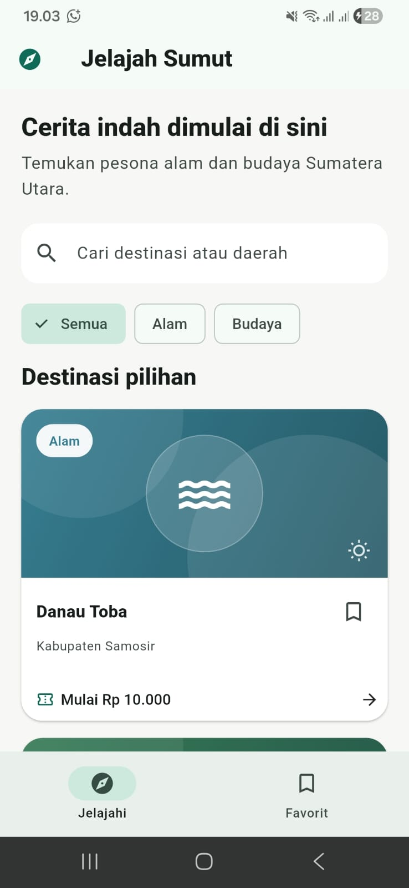
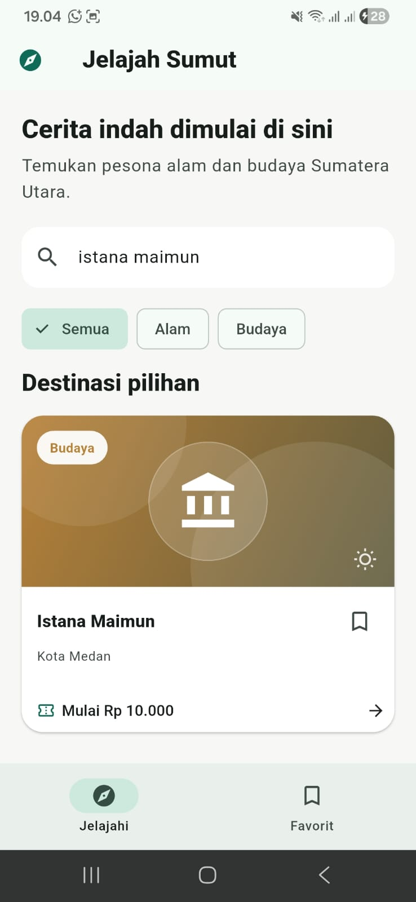
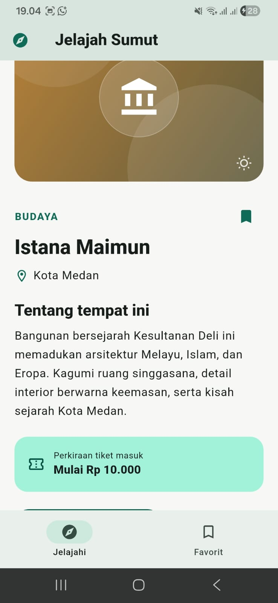
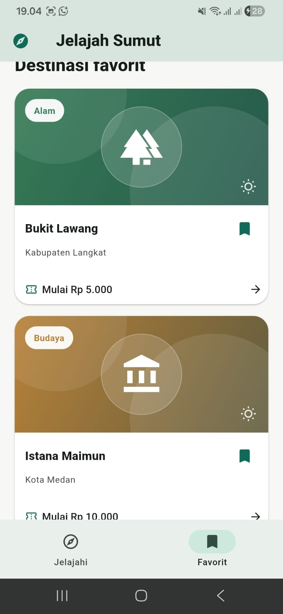

# Jelajah Sumut — Tugas Rutin 6

Aplikasi panduan wisata Sumatera Utara yang menampilkan informasi enam destinasi, perkiraan harga tiket, kategori, dan lokasi. Pilih destinasi untuk membuka halaman detail, atau simpan ke daftar favorit.

## Fitur

- Daftar destinasi dengan pencarian dan filter Alam/Budaya.
- Grid responsif: satu kolom pada ponsel, dua pada tablet, dan tiga pada layar lebar.
- Halaman detail dengan tata letak vertikal atau berdampingan.
- Navigasi `go_router` melalui NavigationBar atau NavigationRail.
- ID destinasi yang tidak dikenal menampilkan pesan “Destinasi tidak ditemukan”.
- Ilustrasi memakai ikon dan warna lokal; aplikasi tidak bergantung pada koneksi gambar eksternal.

## Tangkapan layar

| Daftar destinasi | Hasil pencarian |
|---|---|
|  |  |

| Detail destinasi | Destinasi favorit |
|---|---|
|  |  |

> 

## Keputusan desain responsif

Layout daftar memakai `LayoutBuilder` agar jumlah kolom mengikuti lebar area konten, bukan jenis perangkat. Di bawah 600 dp, kartu disusun satu kolom sehingga informasi destinasi tetap nyaman dibaca pada ponsel 360 dp; dari 600 hingga 999 dp digunakan dua kolom untuk tablet; mulai 1000 dp, daftar memakai tiga kolom untuk layar lebar. Kartu memiliki tinggi tetap, judul dan lokasi dibatasi satu baris dengan ellipsis, dan harga tiket juga dibatasi agar teks panjang tidak mendorong ikon keluar. Detail memakai `Column` pada area di bawah 720 dp: ilustrasi berada di atas informasi sehingga pengguna dapat menggulir secara vertikal. Pada lebar 720 dp ke atas, `LayoutBuilder` mengganti susunan menjadi `Row` dengan area ilustrasi dan informasi berdampingan. `NavigationBar` dipakai ketika lebar kurang dari 840 dp, sementara `NavigationRail` tampil pada layar yang lebih lebar. Breakpoint navigasi dan grid dipilih terpisah agar tablet tetap punya ruang konten cukup. `SingleChildScrollView` di detail menjaga deskripsi panjang tetap dapat diakses; `Stack` menempatkan label kategori di atas ilustrasi. `MediaQuery` hanya dipakai untuk menyingkat teks dekoratif pada AppBar di ponsel.

## Menjalankan aplikasi

```powershell
flutter pub get
flutter run
```

Pemeriksaan proyek:

```powershell
flutter analyze
flutter test
```

## Struktur utama

```text
lib/
  data/         Data enam destinasi
  models/       Model Destination
  router/       Konfigurasi go_router
  screens/      Daftar, favorit, detail, dan shell navigasi
  state/        Penyimpanan favorit
  widgets/      Kartu destinasi, ilustrasi, dan tombol favorit
test/
  widget_test.dart
```

## Pernyataan penggunaan AI

AI digunakan sebagai bantuan untuk menyusun struktur kode, tata letak responsif, teks contoh destinasi, dan pengujian. Kode dan hasil aplikasi ditinjau serta diuji sebelum dikumpulkan.
